# lorequest

Движок текстовых квестов для Telegram с локальной LLM · Telegram text-quest engine with a local LLM

[English](#english) | [Русский](#русский)

<p align="center"></p>
<p align="center"><sub>Illustrative session / Иллюстрация: authored text comes from <code>packs/lighthouse</code>; lines marked ✦ are model output and vary. Rebuild: <code>python tools/make_demo_svg.py</code></sub></p>

## Русский

### Что это

`lorequest` — движок текстовых квестов для Telegram на `aiogram`. Сюжет написан заранее и хранится в YAML-паках (`packs/`), логика игры — в Python (`src/`). Локальная модель (Ollama, без облака и API-ключей) пишет только комментарии рассказчика, «мостики» после свободных ходов, финальный вердикт и свободный чат после концовки. Каждый ответ модели чистится и проверяется, поэтому небольшая локальная модель не уводит историю в сторону.

**Ключевые решения**

| Решение | Как реализовано |
|---|---|
| Сюжет задан автором, модель — только голос | Локации и варианты лежат в `pack.yaml`; модель их не меняет |
| Защита от галлюцинаций | Очистка и валидация ответа (обязательное слово, запрещённые шаблоны, длина), до 3 перегенераций, затем авторская заготовка |
| Проверенные факты | Триггер-слово в выборе игрока → код подставляет факт из списка пака; модель факты не вспоминает |
| Свободный ход не ломает историю | «Мостик» объясняет переход к следующей авторской сцене |
| Генератор квестов `/create` | Диалог в Telegram → локальная модель отдаёт JSON по схеме → код собирает и проверяет `pack.yaml` |
| Безопасные значения по умолчанию | Бот отвечает только владельцу (`access`), `/create` доступна только владельцу (`create`) |

Дополнительно: кнопка-старт и кнопка «дальше» с меняющимися подписями, пасхалки, подсказки `/hint`, секретная концовка, вердикт со ссылками на реальные поступки игрока, прогресс в JSON (переживает перезапуск), необязательная доставка квеста получателю в заданное время (`--deliver`).

### Структура проекта

```
lorequest/
├── bot.py                    лаунчер: python bot.py (добавляет src/ в путь импорта)
├── src/lorequest/
│   ├── __main__.py           python -m lorequest (после pip install -e .)
│   ├── config.py             .env + config.json + флаги CLI -> Settings
│   ├── core/                 ядро без Telegram
│   │   ├── pack.py           загрузка и ПРОВЕРКА pack.yaml
│   │   ├── llm.py            клиент Ollama, ретраи, проверка ответов, запросы по JSON-схеме
│   │   ├── generator.py      /create: генерация и валидация новых паков
│   │   └── store.py          сохранённый прогресс (JSON)
│   └── bot/                  слой Telegram
│       ├── app.py            хендлеры aiogram, FSM, клавиатуры, планировщик
│       └── messages.py       сообщения оператору и диалога /create (en/ru)
├── packs/
│   ├── lighthouse/           демо-пак «The Last Light»
│   ├── template/             шаблон с комментариями
│   └── generated/            результат /create (в .gitignore)
├── docs/pack-format.md       справочник по формату pack.yaml
├── tests/                    проверка паков, генератора и сквозной тест (Telegram и модель подменены)
├── tools/                    eval_models.py (сравнение моделей), make_demo_svg.py
└── .env.example, config.example.json, requirements.txt, pyproject.toml
```

Правило: **контент в `packs/`, поведение в `src/lorequest/`**. Для нового квеста код править не нужно.

### Запуск локально

Нужны: Python 3.10+, [Ollama](https://ollama.com) с моделью, токен бота от [@BotFather](https://t.me/BotFather).

```powershell
# Windows (PowerShell); в Linux/macOS: python3 -m venv .venv && source .venv/bin/activate, cp вместо copy
git clone <URL-репозитория>
cd lorequest
python -m venv .venv
.\.venv\Scripts\Activate.ps1
pip install -r requirements.txt
ollama pull qwen3:8b

copy .env.example .env
copy config.example.json config.json
```

`.env` (токен только здесь, файл в `.gitignore`):

```
TELEGRAM_TOKEN=токен_от_BotFather
OLLAMA_MODEL=qwen3:8b          # точное имя из `ollama list`
```

`config.json`: `owner_id` — ваш Telegram ID (узнать: [@userinfobot](https://t.me/userinfobot)). Остальные ключи опциональны:

| Ключ | Значение |
|---|---|
| `access` | Кто может писать боту: `owner` (по умолчанию), `list` (+ `allowed_ids`), `anyone` |
| `create` | Кто может вызывать `/create`: `owner` (по умолчанию), `allowed`, `off` |
| `recipient_id`, `launch_at` | Только с `--deliver`: кому и когда отправить квест (локальное время ПК, `2026-12-31T00:00:00`) |
| `operator_language` | Язык сообщений оператору: `en` или `ru` |

Запуск из корня репозитория:

```powershell
python bot.py                          # демо-пак packs/lighthouse
python bot.py --pack packs/my_world    # свой пак
python bot.py --deliver                # дополнительно отправить квест получателю в launch_at
python bot.py --reset                  # стереть сохранённый прогресс
```

Откройте бота в Telegram и нажмите `/start`. Приоритет настроек: `.env` > переменные окружения > `config.json` > значения по умолчанию. Логи: `data/bot.log`.

### Как создать свой квест

**Вручную.** Скопируйте шаблон и отредактируйте `pack.yaml`:

```powershell
copy packs\template packs\my_world -Recurse
python bot.py --pack packs/my_world
```

Минимальный фрагмент (локация):

```yaml
locations:
  - id: landing
    title: "🌊 <b>CHAPTER 1: The Landing.</b>"
    body: "The storm has thrown your boat onto the rocks."
    question: "What do you do, traveler?"
    options: ["Knock on the door.", "Climb the cliff path.", "Light a signal fire."]
    custom_label: "Describe your own plan."
    custom_prompt: "The Keeper listens. Describe your plan, traveler."
    context: "A storm-battered landing below a dark lighthouse."   # факты для модели
    instruction: "Comment gravely and a little wryly."             # как реагировать
    fallback: "The Keeper nods, traveler."                         # если модель не справилась
    bridge_premise: "the player finds themselves in the lamp room" # как начинается следующая сцена
```

Загрузчик проверяет пак при старте и называет неверный ключ. Основные разделы:

| Раздел | Назначение |
|---|---|
| `persona` | Системный промпт, подпись рассказчика, few-shot примеры голоса |
| `prompts` | Шаблоны запросов: комментарий, мостик, вердикт |
| `ui` | Все строки интерфейса (бот остаётся «в голосе» персонажа) |
| `locations` | Упорядоченные сцены (2-5 готовых вариантов + свой ввод; `image` — имя файла, `image_prompt` — промпт для генератора картинок) |
| `facts`, `easter_eggs`, `hints`, `secret_ending` | Проверенные факты, пасхалки, подсказки, секретная концовка |
| `final`, `free_chat`, `validation` | Финал и вердикт, свободный чат, правила проверки ответов |

Полный справочник: [docs/pack-format.md](docs/pack-format.md).

**Через `/create`.** Отправьте боту `/create` и ответьте на три вопроса: тема, число сцен (2-6), имя героя. Модель придумывает каркас истории и каждую сцену небольшими JSON-объектами по схеме, каждый объект проверяется (отклонённый ответ возвращается модели с текстом ошибки, до 3 попыток), код собирает пак, валидирует его тем же классом `Pack` и сохраняет в `packs/generated/<имя>/pack.yaml`. Язык определяется по теме. Чтобы сыграть в пак, перезапустите бота с `--pack` (команда будет в ответе бота).

### Тесты

```powershell
python tests\test_pack.py        # валидация паков
python tests\test_generator.py   # генератор: валидаторы, цикл исправлений, сохранение, HTTP-слой
python tests\flow_test.py        # весь квест и диалог /create; Telegram и модель подменены
python tools\eval_models.py --pack packs/lighthouse модель1 модель2   # сравнение моделей, eval_results.md
python tools/generate_pack.py   # интерактивная генерация пака без Telegram
```

### Планы

- `/play`: переключение паков внутри бота (пак на пользователя), чтобы сгенерированный квест запускался сразу.
- Генерация картинок по `image_prompt` и автоподстановка в `image`.
- Необязательный полностью генеративный режим: модель ведёт сцены по скелету актов в рамках схемы.
- Краткое резюме для длинных чатов, больше валидаторов, линтер паков.
- Другие LLM-бэкенды, webhook-режим, БД вместо JSON.

### Лицензия

MIT. Лицензию используемой модели проверяйте отдельно. Токен бота хранить только в `.env`; если он попал в публичное место — сразу перевыпустить в @BotFather.

---

## English

### What it is

`lorequest` is a Telegram text-quest engine built on `aiogram`. The plot is written in advance and lives in YAML packs (`packs/`); the game logic is Python (`src/`). A local model (Ollama: no cloud, no API keys) only writes the narrator's commentary, short "bridges" after free-text moves, a final verdict and the free chat after the ending. Every model reply is cleaned and validated, so a small local model cannot drag the story off course.

**Key decisions**

| Decision | Implementation |
|---|---|
| The author owns the plot, the model only provides the voice | Locations and options live in `pack.yaml`; the model never changes them |
| Hallucination guards | Replies are cleaned and validated (required word, forbidden patterns, length), regenerated up to 3 times, then replaced by an authored fallback |
| Verified facts | A trigger word in the player's choice makes the code attach a fact from the pack's list; the model never recalls facts |
| Free-text moves do not break the story | A "bridge" explains the way to the next authored scene |
| Quest generator `/create` | A Telegram dialog → the local model returns schema-constrained JSON → code assembles and validates `pack.yaml` |
| Safe defaults | The bot answers only its owner (`access`); `/create` is owner-only (`create`) |

Also: a start button and a "continue" button with shuffled labels, easter eggs, `/hint`s, a secret ending, a verdict that quotes the player's real choices, progress stored as JSON (survives restarts), and optional scheduled delivery of the quest to a recipient (`--deliver`).

### Project structure

```
lorequest/
├── bot.py                    launcher: python bot.py (adds src/ to the import path)
├── src/lorequest/
│   ├── __main__.py           python -m lorequest (after pip install -e .)
│   ├── config.py             .env + config.json + CLI flags -> Settings
│   ├── core/                 the engine, no Telegram code
│   │   ├── pack.py           loads and VALIDATES pack.yaml
│   │   ├── llm.py            Ollama client, retries, reply checks, JSON-schema requests
│   │   ├── generator.py      /create: generates and validates new packs
│   │   └── store.py          saved progress (JSON)
│   └── bot/                  the Telegram layer
│       ├── app.py            aiogram handlers, FSM, keyboards, scheduler
│       └── messages.py       operator and /create dialog messages (en/ru)
├── packs/
│   ├── lighthouse/           demo pack "The Last Light"
│   ├── template/             commented template
│   └── generated/            output of /create (git-ignored)
├── docs/pack-format.md       reference for the pack.yaml format
├── tests/                    pack validation, generator, end-to-end flow (Telegram and the model are mocked)
├── tools/                    eval_models.py (compare models), make_demo_svg.py
└── .env.example, config.example.json, requirements.txt, pyproject.toml
```

Rule of thumb: **content goes in `packs/`, behaviour goes in `src/lorequest/`**. A new quest never needs engine changes.

### Run locally

You need Python 3.10+, [Ollama](https://ollama.com) with a model, and a bot token from [@BotFather](https://t.me/BotFather).

```powershell
# Windows (PowerShell); on Linux/macOS: python3 -m venv .venv && source .venv/bin/activate, cp instead of copy
git clone <repository-url>
cd lorequest
python -m venv .venv
.\.venv\Scripts\Activate.ps1
pip install -r requirements.txt
ollama pull qwen3:8b

copy .env.example .env
copy config.example.json config.json
```

`.env` (the token lives only here; the file is git-ignored):

```
TELEGRAM_TOKEN=token_from_BotFather
OLLAMA_MODEL=qwen3:8b          # exact name from `ollama list`
```

`config.json`: `owner_id` is your Telegram ID ([@userinfobot](https://t.me/userinfobot) shows it). The other keys are optional:

| Key | Meaning |
|---|---|
| `access` | Who may talk to the bot: `owner` (default), `list` (+ `allowed_ids`), `anyone` |
| `create` | Who may use `/create`: `owner` (default), `allowed`, `off` |
| `recipient_id`, `launch_at` | Only with `--deliver`: who gets the quest and when (local machine time, `2026-12-31T00:00:00`) |
| `operator_language` | Language of operator messages: `en` or `ru` |

Start it from the repository root:

```powershell
python bot.py                          # demo pack packs/lighthouse
python bot.py --pack packs/my_world    # your own pack
python bot.py --deliver                # also deliver the quest to the recipient at launch_at
python bot.py --reset                  # wipe saved progress
```

Open the bot in Telegram and press `/start`. Precedence of settings: `.env` > environment variables > `config.json` > defaults. Logs: `data/bot.log`.

### Create your own quest

**By hand.** Copy the template and edit `pack.yaml`:

```powershell
copy packs\template packs\my_world -Recurse
python bot.py --pack packs/my_world
```

A minimal fragment (one location):

```yaml
locations:
  - id: landing
    title: "🌊 <b>CHAPTER 1: The Landing.</b>"
    body: "The storm has thrown your boat onto the rocks."
    question: "What do you do, traveler?"
    options: ["Knock on the door.", "Climb the cliff path.", "Light a signal fire."]
    custom_label: "Describe your own plan."
    custom_prompt: "The Keeper listens. Describe your plan, traveler."
    context: "A storm-battered landing below a dark lighthouse."   # facts for the model
    instruction: "Comment gravely and a little wryly."             # how to react
    fallback: "The Keeper nods, traveler."                         # used if the model fails validation
    bridge_premise: "the player finds themselves in the lamp room" # how the next scene begins
```

The loader validates the pack on start and names the broken key. Main sections:

| Section | Purpose |
|---|---|
| `persona` | System prompt, the narrator's label, few-shot voice examples |
| `prompts` | Request templates: comment, bridge, verdict |
| `ui` | Every interface string (so the bot stays in the persona's voice) |
| `locations` | Ordered scenes (2-5 ready-made options + free text; `image` is a file name, `image_prompt` a prompt for an image generator) |
| `facts`, `easter_eggs`, `hints`, `secret_ending` | Verified facts, easter eggs, hints, a secret ending |
| `final`, `free_chat`, `validation` | The ending and verdict, free chat, reply validation rules |

Full reference: [docs/pack-format.md](docs/pack-format.md).

**With `/create`.** Send `/create` to the bot and answer three questions: topic, number of scenes (2-6), the hero's name. The model designs the story frame and each scene as small schema-constrained JSON objects, every object is checked (a rejected answer goes back to the model with the error, up to 3 attempts), and the code assembles the pack, validates it with the same `Pack` class and saves it to `packs/generated/<name>/pack.yaml`. The language follows the topic. To play the pack, restart the bot with `--pack` (the bot prints the command).

### Tests

```powershell
python tests\test_pack.py        # pack validation
python tests\test_generator.py   # generator: validators, repair loop, saving, HTTP layer
python tests\flow_test.py        # the whole quest and the /create dialog; Telegram and the model are mocked
python tools\eval_models.py --pack packs/lighthouse modelA modelB   # compare models, writes eval_results.md
```

### Roadmap

- `/play`: switch packs inside the bot (a pack per user), so a generated quest can be played right away.
- Image generation from `image_prompt` with automatic `image` wiring.
- An optional fully generative mode: the model drives scenes within a schema, guided by an act skeleton.
- A rolling summary for long chats, more validators, a pack linter.
- Other LLM backends, a webhook mode, a database instead of JSON.

### License

MIT. Check the license of the model you run. Keep the bot token only in `.env`; if it ever reaches a public place, revoke it in @BotFather immediately.
